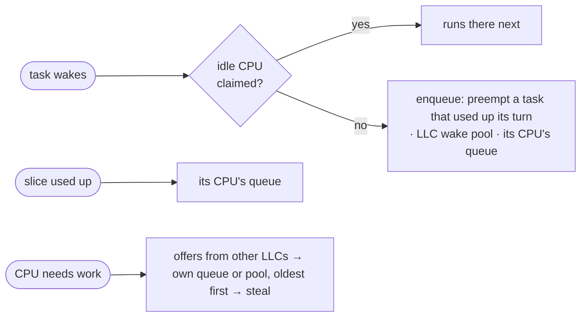

# scx_cake

A Linux `sched_ext` CPU scheduler tuned for games, and fine for everyday use.

| | |
|---|---|
| 🎯 Goal | no task waits while a CPU sits free · tasks stay near their warm cache · CPU time stays fair |
| 🧠 Decides by | how tasks behave and how the CPUs are laid out, never by game name or profile |
| 🍰 Name | after the CAKE network queue manager |

> [!NOTE]
> This README describes this checkout. An installed package may differ: check
> `scx_cake --version` and `scx_cake --help`.

---

## 🚀 Build and run

| Needs | |
|---|---|
| Kernel | `CONFIG_SCHED_CLASS_EXT=y`, BPF, BTF ([kernel config](../../../kernel.config)) |
| Toolchain | the repo's [Rust toolchain](../../../rust-toolchain.toml), Clang with BPF, [build deps](../../../README.md#build--install) |
| Permission | to load a scheduler (your scheduler service or an admin) |

```sh
cargo build --locked --release -p scx_cake   # or: ./scheds/rust/scx_cake/cake build
./target/release/scx_cake --version          # version and binary hash; attaches nothing
./target/release/scx_cake --print-topology   # CPU layout; attaches nothing
./target/release/scx_cake                    # run the default policy
```

| Check | |
|---|---|
| Running? | `cat /sys/kernel/sched_ext/root/ops` starts with `cake` |
| Stop | Ctrl+C gives the CPUs back to the kernel's default scheduler |
| Watchdog | the kernel removes cake if a runnable task waits 5 s; a safety net, not a latency promise |

---

## 🐧 Stock kernel or 🧩 patched kernel

Cake runs on any kernel with sched_ext. The
[experimental-patches](https://github.com/RitzDaCat/experimental-patches) kernel adds
speedups. Cake checks the **running** kernel at start, never the build machine, and
falls back when a feature is missing.

| Feature | Needs | Without it |
|---|---|---|
| Cached rq clock in `ops.running` | 🐧 6.14+ | `scx_bpf_now()` |
| Native CTZ/POPCNT | 🧩 patch 1 + x86 BMI1/POPCNT | portable bit math |
| **Lean idle claim, `lazy` by default** | 🧩 patch 2 | regular idle claim, no warning |
| Direct DSQ index | 🧩 patch 3 (kernel side only) | hash lookup |
| `--kernel-signals` (input/fence wakes, IRQ time) | 🧩 patch 4 | reports it unavailable, runs normally |

Patch numbers follow the `kernel/sched-ext/cachyos-<ver>/` series there. Measured
results: the [STATE.md](./STATE.md) pattern ledger.

---

## 🎛️ Flags

The default needs **no flags**. Apart from the inspect flags, every flag is for testing.

| Flag | Default | Does |
|---|---|---|
| `-h` `--help` | — | list flags and toggles, exit |
| `-V` `--version` | — | version and binary SHA-256, exit |
| `--print-topology` | — | CPU layout and core preferences, exit |
| `-v` `--verbose` | off | libbpf output, startup detail, IRQ-sink changes, kernel event counts at exit |
| `--inspect-bpf NEW_DIR` | off | load the BPF, save its instructions, exit without attaching |
| `--toggle NAME=0\|1` | — | set a toggle; repeatable, last one wins |
| `--handoff-ns NS` | 1464 | change the handoff floor: the slice floor, serial handoff, sub-handoff and deep-idle cutoffs |
| `--lean-idle off\|on\|lazy` | `lazy` | 🧩 lean idle claim; warns only when asked for explicitly and missing |
| `--native-bitops` | auto | require native CTZ/POPCNT; fail without them |
| `--portable-bitops` | off | force portable CTZ/POPCNT |
| `--native-ring` | off | native-CTZ queue scan; hosts with one LLC and ≤ 64 CPU IDs only |
| `--native-hist` | off | native CLZ for the probe histograms (used only with `probe=1`) |
| `--kernel-signals off\|observe\|on` | off | 🧩 `observe` counts the signals; `on` also uses them for placement |
| `--signal-report NEW.csv` | off | save the signal counters at exit (needs `observe` or `on`) |

> [!TIP]
> Unknown options (old `--profile gaming`, `-p powersave` from `scx_loader`) and bad
> toggles are skipped with a warning; **cake still starts**.

| Toggle | Default | Controls |
|---|---|---|
| `probe` | `0` | placement and delay diagnostics, printed at exit (separate from `-v`) |

---

## ⚙️ How scheduling works

**LLC** = last-level cache shared by a group of CPUs · **DSQ** = a `sched_ext` dispatch
queue. Each CPU owns one queue; each LLC has one shared wake pool.



| Weighs | |
|---|---|
| 📍 placement | warm cache · whole idle cores · SMT siblings · big cores first on hybrid CPUs · platform core ranking · IRQ load (measured share, handler running now, next tick) |
| 💺 seat | a CPU that a pipeline-stage task (mean burst ≥ 64 µs) returns to; a preference, not a reservation |
| ⏱️ order | virtual runtime: CPU time scaled by nice weight |
| ✂️ slice | from the task's own run time, age and voluntary switches · floor **1,464 ns** · cap **1.5 ms** · kernel threads placed directly get a flat **3 ms** |

Full rules: [DESIGN.md](./DESIGN.md).

---

## 📏 Limits

| Limit | Value | Past it |
|---|---|---|
| Fast idle claim, seats, one pool per LLC | CPU IDs 0–63 | kernel idle picker, one shared pool |
| Wake pools | 16 LLCs | one shared pool |
| Cache-aware steal order | CPU IDs 0–127 | plain ring walk |
| CPU-ID span | 1,024, possible CPUs included | refuses to start |
| Starvation fallback | fixed **24 ms** | dispatch serves the waiting pool first ([DESIGN](./DESIGN.md#-starvation-fallback-24-ms)) |

---

## 🧪 Tests and bug reports

```sh
cargo test --locked -p scx_cake   # never attaches; the verifier-load test is ignored (needs BPF permission)
```

🐞 Bug report: version or commit · kernel version · CPU · launch arguments · scheduler and kernel logs.

## 🗂️ Source

| File | Purpose |
|---|---|
| [src/main.rs](./src/main.rs) | loader: flags, topology, attach, IRQ-sink monitor |
| [src/core_performance.rs](./src/core_performance.rs) | platform core ranking, read once at start |
| [src/bpf/cake.bpf.c](./src/bpf/cake.bpf.c) | scheduling policy |
| [src/bpf/wake-signals.bpf.h](./src/bpf/wake-signals.bpf.h) | 🧩 `--kernel-signals` reads |
| [src/bpf/intf.h](./src/bpf/intf.h) | shared constants and limits |
| [DESIGN.md](./DESIGN.md) | policy and known limits |
| [STATE.md](./STATE.md) | status, pattern ledger, owed work |
| [docs/README.md](./docs/README.md) | documentation map |
| [bench/README.md](./bench/README.md) | bench tools |

License: GPL-2.0-only.
