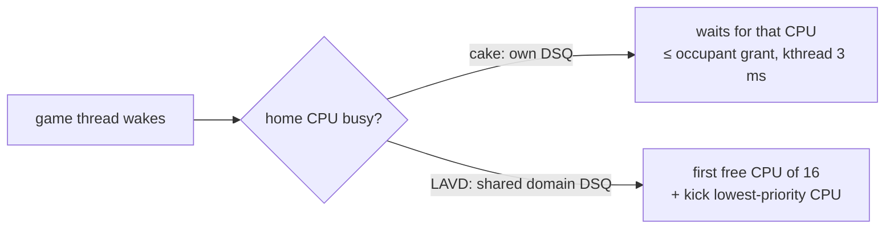

# CPU-bound tail and LAVD-inspired ideas (planned 2026-10-14)

| Status | Kernel | Data |
|---|---|---|
| ⏳ planned, nothing built | 🐧 all stock | `scx_cake_bench/runs/deadlock_4way_20261014/RESULT.md` (r1–r3) |

## ❓ Question

Deadlock CPU-limited (r3): nightly wins avg (+4.3 % vs EEVDF) and 1 % low, but its worst frame
was 5.14 ms in one run (LAVD 2.84, upstream 3.21). Frames > 3 ms: nightly 2, LAVD 0, upstream 1,
cosmos 6, EEVDF 3; frames > 2.5 ms equal (nightly 6, LAVD 5). Normal frame ≈ 1.3 ms, so the spike
is ≈ 3.8 ms late — about one flat kthread `SLICE_NS` (3 ms).

## 1️⃣ First: trace before building

nightly vs LAVD, CPU-limited Deadlock, ~6 × 20 s each (≤ 5 min), MangoHud + perf sched
tracepoints + `cake-bpfstats`. Per slow frame (> p99): did a game thread sit runnable, behind
whom (kthread / other / game), on its home CPU or in the pool? That picks the idea below.

## 2️⃣ Candidates, cross-checked against wins and falsified laws

Wins to protect: `lazy` warm home (~70 % home, 1 % low +7.5 %), seats/retake, §G87 wake preempt,
IRQ-aware placement, §G88 V-cache die, §G98 vtime-lead bound, §G95 pool interlock.
Laws: verified wake-path claims ❌ (§G48, §R.29); a new callback is priced (`ops.quiescent`
futex −84 %, `update_idle` hook +11–16 ms/s); home over-claim ❌ (P3a, futex −13 %); key change
❌ (burstkey worst +52 %).

| # | Idea | Source | Risk to a win | Guard |
|---|---|---|---|---|
| 1 | Pinned kthread wake behind an occupant gets `ENQ_PREEMPT` on the insert | audit C5 (archive, 09-18) | 🟡 seats | never preempt a seat holder; occupant must have run its protect window (§G87 rule) |
| 2 | Non-wake re-enqueue (`alone`) kicks an idle CPU when CPUs idle | audit C2 | 🟢 `lazy` whole-core bit | normal claim order, plain kick, no verify |
| 3 | Home choice reads occupant grant left: divert when occupant is a kthread or past grant | new | 🔴 home rate, P3a | only if the trace shows home waits; reuse `cake.run[cpu]`, no new claim |
| 4 | Kthreads get `cake_task_slice`, not flat `SLICE_NS` | new | 🟢 | change the kthread slice only; `SLICE_NS` feeds vcap / frontier window |
| 5 | Wake→run bound via `ops.tick` (§G5 B1/B4) | §G5 open | 🟡 callback price, seats | run the read-only B2/B3 counters first (≈0 prunes it); skip seat holders; act only on a non-empty own DSQ |
| 6 | LAVD wake-chain priority (waker → wakee inherits) | LAVD `lat_cri.bpf.c:220` | 🔴 §G98, burstkey | inside the sleeper clamp only (≥ frontier − slice), or as placement not vtime credit |
| 7 | Finish wake-class policy and IRQ-woken-first A/B | Owed #11 | 🟢 (PREEMPT half: seats) | seat-holder rule |

Order: trace → #2, #4, #7 (safe) → #1, #5 with guards → #3, #6 only if the trace demands.

## 3️⃣ Boost / packing brainstorm (needs hardware whose clocks move)

9800X3D: every thread ≈ 5.5 GHz with the game running (above the 5.27 GHz rated max), so
none of these can show here.

| Idea | Kernel | Pays on |
|---|---|---|
| Prefer the idle CPU with the highest live `scx_bpf_cpuperf_cur` | 🐧 | laptops, 9950X, Intel hybrid |
| Pack non-game work onto the lowest-ranked cores / frequency die | 🐧 | power-limited parts, dual-CCD X3D |
| VIP cores: best CPPC-ranked cores (4, 5 here) reserved for stage threads | 🐧 | any ranked part |
| Whole-core packing under light load (never SMT-pair), rest reach deep idle | 🐧 | power-limited parts |
| Probe first: per-core effective clock at 1 / 4 / 8 / 16 busy threads | — | gate for the rows above (rodata-gated on flat hosts) |
