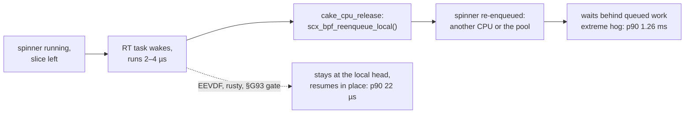

# Spin latency under stress: resume in place, then fewer chops (planned 2026-10-28, reproduced 2026-10-29)

| Status | Kernel | Data |
|---|---|---|
| 🧪 reproduced and attributed 2026-10-29 (extreme and high_gaming, EEVDF vs HEAD `58601ccdd`) · ❌ §G99 release hold built and rejected 2026-10-29 (overshoot fixed, sleeper wake delay ×150) · §G93 gate not built | 🐧 all stock · §G99's hold is stock, its `ops.stopping` move needs `scx_bpf_dsq_reenq` (7.1+), else `cpu_release` stays · arm C needs `ops.cpu_release` (6.12+; deprecated since 6.19, 7.2 warns at load; without the op the kernel resumes the task in place) · F1 needs sched_ext `ops.yield` (6.12+) · F2 needs the x86-64 `__preempt_count` ksym (weak; `pcpu_hot` on 6.12–6.14), else the hooks stay | a tester's charts, pasted 2026-10-28 (EEVDF, cake, rusty; their script is not local) · local runs `scx_cake_bench/runs/spinstorm_20261029/` (gitignored) · tools `scx_cake_bench/bench/spinlat/` (untracked) · stress-ng recipe in the evidence at the end |

## ❓ Question

A tester timed a spinning thread under six stress-ng loads. Cake has the best long-spin
tails and "% off", but it loses every median, and extreme by 19×.

Mean of median latency, ns (lower is better):

| Situation | EEVDF | cake | rusty | cake vs best |
|---|---|---|---|---|
| extreme | 1106.9 | 8967.5 | **470.7** | ❌ ×19.1 |
| high_gaming | 1300.2 | 80.3 | **54.2** | ❌ +26.1 |
| med_gaming | 48.9 | 45.3 | **43.0** | ❌ +2.3 |
| desktop | **41.2** | 42.9 | 42.8 | ❌ +1.7 |
| idle | 39.4 | 38.6 | **37.4** | ❌ +1.2 |
| low_gaming | 42.3 | 38.2 | **37.8** | ❌ +0.4 |

| Chart (spins of 5–1000 µs) | ✅ cake first | ❌ cake not first |
|---|---|---|
| max | 10 µs and ≥ 300 µs (1000 µs: 2.2 µs vs EEVDF 27.3, rusty 24.5) | worst at 5, 20, 50, 80, 100 µs (13–20 µs vs 2–9); second at 200 µs |
| avg | ≥ 200 µs | worst at 20–100 µs |
| median | — | second to rusty at ≥ 300 µs by 1–10 ns (300 µs: 51 vs 41) |
| "% off" sweep | 19 of 24 points | 20 µs (both modes), 100 and 300 µs with pause, 500 µs without |

How the charts probably read (inferred; step 0 asks the tester):

| Reading | Inference | Evidence |
|---|---|---|
| heatmap cell | overshoot past the spin's deadline, one sample per spin | a 1000 µs spin at HZ 1000 always spans a tick, yet its median is 41–58 ns |
| "% off" | wall-time inflation of a fixed-work spin | — |
| situation bar | mean over the 12 durations of each duration's median | — |
| spinner | sleeps between spins | local EEVDF extreme: sleeper 982 ns ≈ tester 1,107 (CPU hog 6,121, pinned 9,529) |
| what each rewards | the median rewards rare interruptions; avg, max and "% off" reward short ones | cake wins the second group |

| Scheduler | Interrupts the spinner | Because |
|---|---|---|
| cake | often and briefly; under RT load, moves it | a waker may preempt after min(wakee slice, 187.5 µs); a tiny sleeper's slice is ~1.5 µs · every RT run re-enqueues it elsewhere (S8) |
| rusty | rarely, for long | 1 ms (overutil) / 20 ms slices, no wake preemption, no `cpu_release` |
| EEVDF | in between | RUN_TO_PARITY protects curr for up to the 0.7 ms base slice; BATCH and IDLE wakers never preempt |

## 🧪 Result 2026-10-29: S8 is the door

| | Finding |
|---|---|
| ❌ | Cake reproduces the median loss. With RT stressors (`ulimit -r` 99, as the tester likely ran) S8 explains it: after a 2–4 µs RT run `cake_cpu_release` re-enqueues the spinner, and it resumes on the same CPU only 7–28 % of the time (EEVDF 100 %), after a queue wait |
| ❌ | S8 also costs CPU: cake BPF uses 3.51 CPUs in extreme with RT (`cake_dispatch` 879.5 ns/run, 161.8 without RT), and IWI, the irq_work that carries every `scx_bpf_kick_cpu`, runs at 1.13 M/s next to 1.06 M releases/s |
| ❌ | Without RT stressors, PipeWire `data-loop.0` (FIFO 88/83) and `rcu_preempt` (FIFO 1) still trip S8: the extreme sleeper waits p90 3.9 ms, p99 8.0 ms after them (other takers: mean 23 µs) |
| ➖ | Without RT the sleeper ties (38.5 vs 38.7 ns). CPU-bound spinners lose the median to S1 chops by stress-ng wakers but win avg and p99 at most durations: a trade |
| ✅ | Cake wins max at nearly every point, and avg and p99 everywhere except the unpinned spinners in extreme with RT. The pinned spinner, which S8 cannot move, wins every chart in extreme with RT |
| ⚠️ | 16 CPUs here: the fixed stressor counts oversubscribe more than on the tester's host (CPU count unknown), so magnitudes are larger, and high_gaming ranks differently (tester: cake 80 ns beat EEVDF 1,300; here cake loses) |

Median overshoot per duration, all slots pooled, averaged over the 12 durations, ns (RT runs 6
slots per arm, no-RT runs 4; p is an exact Mann-Whitney on the per-slot values):

| Situation | Spinner | RT: EEVDF | RT: cake | p | No RT: EEVDF | No RT: cake | p |
|---|---|---:|---:|---:|---:|---:|---:|
| extreme | sleeper | 981.6 | ❌ 242,510.7 | 0.002 | 38.7 | ➖ 38.5 | 0.34 |
| extreme | hog | 6,120.8 | ❌ 486,995.1 | 0.002 | 664.4 | · 30,774.6 | 0.34 |
| extreme | pinned | 9,529.4 | · 2,492.5 | 0.065 | 969.8 | ❌ 31,688.6 | 0.029 |
| high_gaming | sleeper | 3,814.7 | ❌ 6,928.6 | 0.009 | 39.3 | ➖ 38.3 | 0.83 |
| high_gaming | hog | 1,244.1 | ❌ 10,911.5 | 0.002 | 39.9 | ❌ 3,135.8 | 0.029 |
| high_gaming | pinned | 1,989.1 | ❌ 10,217.9 | 0.002 | 208.8 | · 3,149.4 | 0.057 |

`·` = not significant: EEVDF's extreme no-RT hog slots span 43–62,757 ns; the extreme RT pinned
slots are cake 2.3–3.0 µs vs EEVDF 1.3–22.3 µs.

Durations of 12 where cake beats EEVDF:

| Run | Spinner | median | avg | p99 | max |
|---|---|---:|---:|---:|---:|
| high_gaming, RT | hog · pinned · sleeper | 0 · 0 · 3 | 7 · 8 · 12 | 11 · 11 · 11 | 12 · 12 · 12 |
| extreme, RT | hog · pinned · sleeper | 0 · 10 · 0 | 0 · 12 · 0 | 0 · 12 · 0 | 12 · 12 · 12 |
| extreme, no RT | hog · pinned · sleeper | 1 · 0 · 1 | 8 · 9 · 10 | 11 · 11 · 7 | 10 · 12 · 5 |
| high_gaming, no RT | hog · pinned · sleeper | 0 · 0 · 1 | 9 · 9 · 11 | 10 · 10 · 12 | 6 · 7 · 11 |

After an RT taker (`stress-ng-hrtimers` RR, `stress-ng-cpu-sched` children), perf `sched_switch`, one slot per arm:

| Situation | Spinner | cake: off-CPU med / p90 / p99 µs | cake: same CPU | EEVDF: off-CPU med / p90 / p99 µs | EEVDF: same CPU |
|---|---|---|---:|---|---:|
| extreme | hog | 34 / 1,258 / 2,402 | 27.6 % | 5 / 22 / 132 | 100 % |
| extreme | sleeper | 5 / 33 / 1,801 | 6.9 % | 4 / 16 / 401 | 100 % |
| extreme | pinned | 5 / 18 / 58 | 100 % | 5 / 94 / 719 | 100 % |
| high_gaming | hog | 18 / 53 / 139 | 15.0 % | 4 / 27 / 57 | 100 % |
| high_gaming | sleeper | 6 / 42 / 115 | 13.1 % | 8 / 31 / 78 | 100 % |
| high_gaming | pinned | 16 / 56 / 110 | 100 % | 13 / 39 / 106 | 100 % |

After a non-RT taker cake resumes on the same CPU 100 % of the time (unpinned spinners: off-CPU
p99 16–24 µs). The high_gaming pinned spinner also loses with RT (×5.1): the same takers at the
same rate (30.7 k vs 30.9 k/s), but each RT stop keeps it off longer (p90 56 vs 39 µs) and it is
late at more deadlines (75.6 % vs 56.0 %). The re-enqueue returns it to its own CPU but not at
the head (inferred), so arm C should cover it too.

Release census (`--toggle probe=1`, one extreme slot with RT): 59.9 M releases, 96.0 % RT and
4.0 % stop class (migration), no DL. 51.8 M displaced a task with slice left (8.1 M had none,
39 were immed); in 97.9 % of those the displacer's mean burst (`sum_exec_runtime / nvcsw`) was
2–4 µs. The higher class held the CPU under 16 µs in 99.1 % of releases (2–8 µs in 86.6 %).
The kick after a release (`release_serve`) fired 64 times, so the cost is the re-enqueue itself.

Every path that takes a busy occupant's CPU, read from HEAD `58601ccdd` (verdicts updated with the 10-29 runs):

| # | Path (`cake.bpf.c`) | What it does to a busy occupant | Verdict |
|---|---|---|---|
| S1 | wake preempt 2276 and probe 2308, via `cake_wake_protect` 1659 | protect = min(wakee slice, `SLICE_NS >> 4` = 187.5 µs); the slice floor `cake_handoff_max_ns` is 1464 ns, so a tiny sleeper chops after ~1.5 µs | ➖ measured trade (no RT): CPU-bound spinners late 58–80 % vs 32–43 %, but the late residual p90 is 69–216 µs vs 0.7–1.7 ms; ✅ §G87 by design (cyclictest spikes > 100 µs: 230–6331 → 10–14) |
| S2 | dispatch refill 2996, then `EXPIRY_PREEMPT` 2491 | a refilled occupant reads past its grant, so a continuation wake homed there preempts with no protect or vtime test | ➖ 1,956 in the probe slot (0.00 % of selects) |
| S3 | pinned kthread 2417, own-DSQ `pin` 2540, both via `cake_pinned_wake_preempt` 2369 | no protect (`cran` is computed, never read), no seat or starved exemption | ❌ gap; `pinned_preempt` 3.9 % of selects in the probe slot; its share of the spinner's chops is not split |
| S4 | every wake verdict | SCHED_BATCH and SCHED_IDLE wakers chop like nice 0 (EEVDF never lets them preempt); nice 19 too, since the admission floor is weight-blind | ❌ gap for BATCH/IDLE; not measured separately; nice is a key change, out of scope |
| S5 | no `ops.yield` | the kernel zeroes the slice and the yielder keeps its key (EEVDF pushes its deadline back one slice) | 🧪 F1; not measured |
| S6 | `cake_pending_spin` 2772 | up to `CAKE_PEND_SPIN_MAX` (4) self `PREEMPT` kicks while a pool landing is pending | ➖ `pend_kick` fired once in the probe slot |
| S7 | IRQ hooks 949–970 | four tracepoints on every hardirq and softirq edge; `irq_leave` costs 550–1,010 ns/run (Owed #5) | 🧪 F2; here device IRQs ran 1.5–3.5 k/s (`irq_leave` 0.6–1.4 µs/run, under 0.01 CPU) |
| S8 | `cake_cpu_release` 3107 | every RT/DL/stop displacement re-enqueues the displaced task (`scx_bpf_reenqueue_local`) to an idle CPU or the pool; rusty and EEVDF resume it in place | ❌ measured: the whole RT-load loss (above); §G93's gate (designed 09-18) was never built |

## ❌ Result 2026-10-29: holding the pick (§G99)

Two builds aimed at arm C's goal, resume in place, without the §G93 burst gate: a pick that a
higher class displaces keeps its local head unless an idle CPU on its die is free.

| Build | Change | Kernel |
|---|---|---|
| v1 reflex `a408bf70` | with `scx_bpf_dsq_reenq` the loader unregisters `ops.cpu_release`; `ops.stopping` takes a runnable pick with slice left and no IMMED: no idle CPU on its die → it stays at the local head; else `scx_bpf_dsq_reenq(SCX_DSQ_LOCAL)` plus an idle claim and kick for own-queue work. The stopping charge stays, so the protect clock restarts | 🐧 hold stock · the move needs `scx_bpf_dsq_reenq` (7.1+), else `cpu_release` stays |
| v2 hold `8c3f84de` | v1, and a held pick skips the stopping charge while `ops.running` backdates the stamp, so the protect clock carries across the hold; `cpu_release` (probe or pre-7.1) returns early for a held pick | same |

Extreme with RT, 6 × 20 s per arm, ABBA against the clean HEAD receipt, all slots valid and `noisy`:

| Measure | HEAD (v1 run · v2 run) | v1 | v2 |
|---|---:|---:|---:|
| hog median overshoot | 485.7 · 487.7 µs | ✅ 34.1 µs | ✅ 38.0 µs |
| sleeper median overshoot | 260.5 · 276.2 µs | ✅ 46.0 ns | ✅ 47.3 ns |
| pinned median overshoot | 2.26 · 2.18 µs | ❌ 47.5 µs | ❌ 43.0 µs |
| sleeper spins per slot | 10,607 · 10,666 | ❌ 3,504 | ❌ 3,682 |
| sleeper wake delay p50 / p90 / p99 | 24 / 65 / 1,570 · 24 / 64 / 1,538 µs | ❌ 3,853 / 10,709 / 15,323 µs | ❌ 3,676 / 9,443 / 14,973 µs |
| context switches/s | 4.94–4.99 · 4.91–5.03 M | 6.42–7.44 M | 6.89–7.78 M |
| interrupts/s | 2.60–2.66 · 2.62–2.67 M | 1.62–1.72 M | 1.68–1.73 M |
| IWI/s | — · 1,134 k | — | 69 k |
| `external_cpu_avg_pct` | 17.8–32.4 · 23.3–27.3 % | 24.3–34.8 % | ⚠️ 40.8–101 % (unexplained) |

Every median above: p = 0.0022 (exact Mann-Whitney, 6 v 6). Wake delay = next spin start −
(spin end + 1 ms sleep), from each slot's `spin_sleeper.csv` (`bench/spinlat/wakedelay.py`). The
sleeper's overshoot fell because it ran a third as many spins: once on a CPU it spins clean, but
its 1 ms sleep ends 3.7–3.9 ms late at p50.

| | |
|---|---|
| ❌ verdict | a sleeper-type thread (a game's audio or input loop) waking 3.7 ms late outweighs every overshoot win; the pinned spinner loses ×20 |
| ❓ cause | open. v1 and v2 match, so the protect-clock carry is not it (falsified). Hypothesis: held picks sit at local heads while RT runs, and a wake homed on such a CPU waits behind the held pick, since the hold applies only when no idle CPU is free on the die |
| v3 | trace where the sleeper waits (`sched_wakeup` → `sched_switch` per CPU), then one of: a long-hold rescue (move the held pick once the RT burst outlives a bound), an RT-end dispatch pump, or the §G93 burst gate in `cpu_release` |

IBS, one slot per arm (`ibs/extreme_20261029T124900`; `perf record -e ibs_op// --sample-mem-info -d -W -g -a -F 2500`, bpf_stats on; `bench/locality/ibs_bullseye.py`):

| | HEAD `ffff4775` | v2 `8c3f84de` |
|---|---:|---:|
| context switches/s | 18.9 M | 30.1 M |
| `cake_dispatch` | 912.7 ns at 2.90 M/s | 158.3 ns at 4.28 M/s |
| BPF total (bpf_stats) | 3.36 CPUs | 1.23 CPUs |
| BPF + sched_ext core (IBS) | 4.65 CPUs, 246 ns per switch | 2.23 CPUs, 74 ns per switch |
| IWI/s | 4.33 M | 0.32 M |

| Where HEAD's `cake_dispatch` goes (IBS samples) | Share |
|---|---:|
| lock spin inside `scx_bpf_dsq_move_to_local` (`switch_rq_lock`, `scx_consume_dispatch_q`, `scx_dispatch_dequeue`) | 50 % |
| the move itself · its psi update · its clock read | 15 % · 14 % · 4 % |
| DSQ hash lookup in `scx_bpf_dsq_nr_queued` · `scx_bpf_dsq_peek` | 4 % · 4 % |
| loads served from a peer's modified line (HitM) | 8.3 % of loads (v2 2.1 %) |

| Measuring note | |
|---|---|
| stats clock | the bpf_stats clock in the trampoline is 22–57 % of the small callbacks' samples (`running`, `stopping`, `select_cpu`, `enqueue`): stats on inflates them |
| `irq_leave` | bpf_stats reads 0.6–1.4 µs/run, but IBS caught 0–1 samples of ~80 expected (expected = ns/run × runs/s ÷ (busy CPUs × 1e9) × total samples): the time sits in the stats window, not the program |
| regime | both IBS slots switched faster than the scored slots (4.9 M/s); compare per switch |
| latencies | IBS load latency: L2 ~11 cycles, L3 ~84, peer HitM ~74–76 |

## 1️⃣ Reproduce and attribute

| Step | What | How | Status |
|---|---|---|---|
| 0 | Ask the tester: script, spinner policy/nice/affinity, CPU count, kernel, HZ, EEVDF base slice, whether stress-ng could set RT | one message | ⏳ CPU count and RT decide how far local magnitudes transfer |
| 1 | `spinlat`: deadline spins over the 12 durations, pause flag; per spin: overshoot, largest gap, interruptions, stolen time, csw deltas, CPU at start and end | `scx_cake_bench/bench/spinlat/` (C, user mode) + `spinstorm.py`, `spinstorm_report.py`, `spin_switch.py` | ✅ |
| 2 | 6 situations × {EEVDF, cake HEAD}: 20 s slots, one condition per run, ≤ 5 min | `spinstorm.py` with the harness noise sampler (`noise_class`, `external_cpu_avg_pct`) | 🧪 extreme and high_gaming, with and without RT; med_gaming, desktop, low_gaming, idle owed |
| 3 | Probe counters and the release census | `--toggle probe=1` | ✅ one extreme slot |
| 4 | Who takes the spinner's CPU, for how long, and where it resumes | perf `sched_switch` + `spin_switch.py` (instead of `cakebench wake-latency`) | ✅ |
| 5 | At each wake verdict: pool pending, served age, the target's chop streak (test-only counters) | probe build | ⏳ only if arm B reopens |
| 6 | Mild situations (0.4–2.3 ns): matched slots, `perf stat` cycles per spin iteration, SMT sibling busy share, IRQs per second | `perf stat`, `/proc/interrupts` | ⏳ |

| Run note | |
|---|---|
| memory | `--vm-bytes 40G` is shared by the 8 vm workers; 68 GB is available here |
| disk | `--hdd-bytes 2G` is per worker, so extreme writes 6 GB per slot: `--temp-path` points at a scratch directory |
| RT policies | `ulimit -r` is 99 here, so stress-ng runs FIFO/RR children as the user; `--no-rt` gives stress-ng `RLIMIT_RTPRIO` 0 (PipeWire and `rcu_preempt` stay RT) |
| teardown | stress-ng's sleep stressor logs one "sleep underrun" in 11 of 26 cake slots and 2 of 26 EEVDF slots, always at the runner's group SIGINT: an artifact, not a timing fault; why cake trips it more often is unknown |
| rusty | needs a maintainer-approved setcap helper; until then use the tester's numbers |

## 2️⃣ Proposed change, in order

**Arm C first (S8): build §G93's gate.** `cake_cpu_release` re-enqueues only when the
displacer's measured burst (`args->task`: `sum_exec_runtime` against nvcsw + nivcsw,
cross-multiplied, no divide) exceeds the displaced task's refill; a short RT run leaves the
task at the head of its local DSQ, as rusty and EEVDF do. 🐧 `ops.cpu_release` (6.12+;
deprecated since 6.19 and 7.2 warns at load; moving to the `sched_switch` hook with
`scx_bpf_dsq_reenq` is a separate item). Game value: KWin and PipeWire RT threads displace
game threads, and the census says almost every displacer runs 2–4 µs. Guard: a FIFO task
with bursts longer than the refill must still move the displaced task.

Then one chop rule. Every path that takes a busy occupant's CPU for a wakee (S1, S3) runs the
same front gates, cheapest first: policy, protect, then the vtime test, then starved and
seat. The gates become one helper that `cake_wake_preempt` and `cake_pinned_wake_preempt` both
call; each keeps its own vtime test, since a BPF call takes at most five arguments.

| Test | Today | Change | Kernel | Fixes |
|---|---|---|---|---|
| T1 | pinned paths preempt seat holders and starved stages | the seat and starved exemptions of `cake_wake_preempt` | 🐧 | S3 |
| T2 | BATCH and IDLE wakers chop | a SCHED_BATCH or SCHED_IDLE waker never chops (EEVDF `fair.c:9964`); one load of `p->policy`, tested before the occupant read | 🐧 | S4 |
| T3 | pinned paths have no protect | `cran` ≥ min(wakee slice, `SLICE_NS >> PREEMPT_PROTECT_SHIFT`) | 🐧 | S3 |
| T4 | protect is fixed per wakee | protect grows under chop pressure (T4a or T4b); kthread wakers keep today's protect, for display and softirq service | 🐧 | S1 in storms |
| T5 | vtime gate | unchanged (wake: lower live vtime; pinned: sleep-depth key plus the slice margin) | 🐧 | — |

T3's price: a refused pinned wakee cannot go elsewhere, so it waits out the occupant's
grant (≤ `CAKE_GRANT_CAP_NS`, 1.5 ms), not only the protect. Ship T3 only if step 4 shows
pinned chops on the spinner and kthread wake-to-run holds.

T4, chop pressure; step 5 picks one, and only if a game shows S1 costing frames, since the
measured S1 trade wins avg and p99:

| | T4a pool gate | T4b chop streak (lean) |
|---|---|---|
| Rule | a non-kthread wakee joins the pool, skipping the chop and the 3 probes, when `cake_pool_pending(llc)` and `pool[llc].served` is younger than its protect | per CPU, in `ops.stopping`: runnable with used < `rs->grant` and < 187.5 µs is a chop, +1; any run ≥ 187.5 µs, −1; wake protect = min(slice << streak, the cap) |
| State | none new | 3 bits of `rs->hint`, which the owner already writes each switch |
| Cost | reads the contended pool line before the chop | none new: the remote reader already loads that line (`pid`, `stamp`); stopping adds a compare |
| Keeps §G87 because | an empty pool never gates | cyclictest's 1 ms cadence makes no short chop, so its protect stays the bare slice |
| Fails when | chops keep the pool empty, so the gate never opens; µs ages on cached rq clocks | a latency task inside a storm queues like the sleepers (rerun the §G87 check under storm loads) |

Expected effect (a hypothesis until the harness says so; "today" is local, 2026-10-29):

| Chart | Today | Arm | Why |
|---|---|---|---|
| RT medians, unpinned spinners | ×1.8–247 EEVDF | C | the spinner resumes in place after a 2–4 µs RT run, as on EEVDF and as the pinned control does |
| RT avg and p99 in extreme, unpinned | lose at all 12 durations | C | no queue wait (hog after an RT taker: p90 1,258 µs vs EEVDF 22) |
| cake BPF CPU with RT | 3.51 CPUs (`cake_dispatch` 2.73) | C | ~1.06 M re-enqueues/s stop; dispatch back toward 162 ns/run |
| interrupts with RT | 2.59–2.68 M/s vs 1.39–1.62 M (IWI 1.13 M/s) | C | fewer re-enqueues, fewer kicks (inferred: IWI runs near the release rate) |
| extreme no-RT sleeper p99 at long spins | 1000 µs: 5.7 ms vs 2.9 | C | `data-loop.0` and `rcu_preempt` releases stop moving it |
| no-RT medians, CPU-bound spinners | 3.1–31.7 µs vs 0.04–0.97 | B, on game evidence only | S1 chops; the trade wins avg and p99 |
| mild medians | +0.4–2.3 ns (tester) | unknown | not chops: step 6 first, then F2 or F4 |
| long-spin avg, max, "% off" | ✅ mostly first | must hold | — |

Order: step 0 → arm C (the §G93 gate or a v3 hold; §G99 ❌) → rerun extreme and high_gaming, with and without RT → arm A (T1 + T2 + T3)
→ the four remaining situations and step 6 → arm B on game evidence → F1, F2 → F4 on evidence.

## 3️⃣ Follow-ups

| # | Idea | Kernel | Pays on | Risk | Guard |
|---|---|---|---|---|---|
| F1 | `ops.yield`: slice 0 and the key pushed back one weighted slice, inside the §G98 lead bound | 🐧 sched_ext 6.12+; the op must zero the slice itself | `--yield`, `--resched` | Proton's `SwitchToThread` and `Sleep(0)` call `sched_yield`: a game spin-wait would hand its CPU away | game A/B first; a new callback is priced |
| F2 | live IRQ depth from the target's `__preempt_count` (`HARDIRQ_MASK \| NMI_MASK \| SOFTIRQ_OFFSET`) via `bpf_per_cpu_ptr`, replacing the 4 tracepoints; also sees timer and IPI handlers | 🐧 x86-64: `__preempt_count` (6.15+), `pcpu_hot.preempt_count` (6.12–6.14); weak ksym + `bpf_ksym_exists`; other arches keep the hooks | every IRQ on every CPU (S7) | the read pulls the target's cache-hot line, which its owner writes on every preempt_disable | price the reads against the hooks' per-IRQ cost |
| F3 | pending spin kicks without `PREEMPT` | 🐧 | S6 | a refilled prev keeps the CPU and the kick never reaches dispatch | ➖ dropped: `pend_kick` fired once in the probe slot |
| F4 | long runners prefer an idle SMT sibling and a high-rank core | 🐧, rodata-gated | the mild 0.4–2.3 ns gaps | `lazy` home rate | only if step 6 attributes the gap; the 9800X3D cannot show it (every thread ~5.5 GHz) |

## 📏 Measurement and guards

| Level | Measure | Pass |
|---|---|---|
| 1 game | KovaaK's CPU-limited (uncapped, low res) and GPU-limited (cap or high res), 6 × 20 s per condition | avg, p99, 1 % low, 0.1 % low and worst frame no worse than HEAD |
| 2 appsim | `cakebench cost` | p99 and 0.1 % low no worse |
| 3 kernel wall | `cake-bpfstats` ns/run per callback at matched host busy; `spinstorm.py` extreme and high_gaming, with and without RT | each arm priced; same-CPU resume after an RT taker near 100 %; `cake_dispatch` with RT near its no-RT price; medians move toward EEVDF and rusty; long-spin avg, max and "% off" hold |
| guards | cyclictest spikes > 100 µs (§G87: 10–14) on HEAD and each arm, idle and under extreme and high_gaming; a long-burst FIFO task still moves the displaced task; §G85 renderer preempts/s; seat retakes; `lazy` home rate; §G98 lead; §G95 counters | unchanged or better |

Wins to protect: `lazy` warm home, seats/retake, §G87 wake preempt, IRQ-aware placement, §G88
V-cache die, §G98 vtime-lead bound, §G95 pool interlock, and cake's long-spin avg, max and "% off" lead.
Laws: a new callback is priced (`ops.quiescent` futex −84 %); verified wake-path claims ❌ (§G48,
§R.29); key change ❌ (burstkey worst +52 %); spread pick ❌ (select +8 ns); price atomics by line
ownership (pool packing ❌); every threshold reuses an existing constant.

<b>Evidence 2026-10-29</b>: local runs, prices, interrupts, late split

Host 9800X3D, 16 CPUs, `7.3.0-5-cachyos`, HZ 1000. Cake: clean HEAD `58601ccdd` receipt,
sha256 `ffff4775ba73…`, ops `cake_1.2.1_x86_64_unknown_linux_gnu`, no args unless noted.
Scored slots: all valid, `noise_class` low to noisy, `external_cpu_avg_pct` 3.7–18.9 % from 5–20
noise samples, host busy 100 %, spins 20.0–20.9 s.

| Caveat | |
|---|---|
| noise sampler starved | in two unscored EEVDF slots (perf `005452`, price `011423`) it ran once, so their 344 % and 114 % are one interval; those slots give only switch attribution and interrupt counts |
| unstable cake regime | cake's extreme-RT switch rate was 4.36–4.96 M/s in the scored, probe and `011423` slots, but 7.20 M/s in `011125` (empty bpf snapshot, unused) and 11.84 M/s (interrupts 6.19 M/s) in perf slot `005452`, which the extreme perf table comes from; unexplained |
| perf adds load | high_gaming perf slots switched 5.9 M/s on both arms (scored 4.57–5.02 M) |

| Run (`scx_cake_bench/runs/spinstorm_20261029/`) | What | Slots |
|---|---|---|
| `high_gaming_20261029T003514` | scored, RT allowed | 6 per arm, 20 s |
| `extreme_20261029T004137` | scored, RT allowed | 6 per arm, 20 s |
| `nort/extreme_20261029T010105`, `nort/high_gaming_20261029T010644` | scored, `--no-rt` | 4 per arm, 20 s |
| `attrib/extreme_20261029T004917` | `--toggle probe=1` census, perf | 1 per arm |
| `attrib/extreme_20261029T005452`, `attrib/high_gaming_20261029T005856` | perf `sched_switch`, RT; `switch_summary.txt` | 1 per arm |
| `price/extreme_20261029T011423` · `price/extreme_20261029T011600` | `--bpfstats`, RT · `--bpfstats --perf --no-rt` | 1 per arm |
| `reflex/extreme_20261029T121359` · `reflex/extreme_20261029T123410` | §G99 v1 · v2 vs HEAD, RT (`--cake-b`); v2 source `reflex/hold_v2_8c3f84de.patch` | 6 per arm, 20 s |
| `ibs/extreme_20261029T124900` | IBS + `--bpfstats`, HEAD vs v2; `bullseye.json` | 1 per arm |

Commands: `python3 bench/spinlat/spinstorm.py --situation <s> --cake <receipt>/scx_cake --out <dir>
[--slots 4] [--no-rt] [--perf] [--bpfstats] [--cake-arg=--toggle --cake-arg=probe=1]`, then
`spinstorm_report.py <run>` and `spin_switch.py <slot>`. `--bpfstats` needs
`sudo -n /usr/local/libexec/cake-bpfstats enable` first and `disable` after.

Callback prices, extreme, window from stress start to stop:

| Callback | RT: ns/run | RT: runs/s | RT: CPUs | No RT: ns/run | No RT: runs/s | No RT: CPUs |
|---|---:|---:|---:|---:|---:|---:|
| `cake_dispatch` | 879.5 | 3.10 M | 2.73 | 161.8 | 5.40 M | 0.87 |
| `cake_enqueue` | 95.8 | 3.84 M | 0.37 | 57.2 | 6.47 M | 0.37 |
| `cake_cpu_release` | 191.8 | 1.06 M | 0.20 | 212.0 | 38.5 k | 0.01 |
| `cake_running` | 28.6 | 3.31 M | 0.09 | 23.0 | 6.13 M | 0.14 |
| `cake_stopping` | 19.6 | 3.31 M | 0.06 | 16.5 | 6.13 M | 0.10 |
| `cake_select_cpu` | 34.0 | 1.28 M | 0.04 | 33.3 | 0.89 M | 0.03 |
| `cake_irq_leave` | 1,422.3 | 1.5 k | 0.00 | 606.7 | 3.5 k | 0.00 |
| total | | | 3.51 | | | 1.53 |

| Per second, during the spins | cake | EEVDF |
|---|---|---|
| interrupts, RT (scored runs) | 2.59–2.68 M | 1.39–1.62 M |
| interrupts, no RT | extreme 0.76–0.80 M · high_gaming 1.20–1.22 M | 0.55–0.62 M · 0.61–0.66 M |
| by type, extreme RT (price `011423`) | IWI 1.13 M · RES 373 k · LOC 1.06 M | IWI 20 · RES 269 k · LOC 1.13 M |
| by type, no RT | extreme (price `011600`) IWI 148 k · RES 342 k · LOC 325 k; high_gaming IWI 160–190 k · RES 270–280 k | IWI 21 · RES 125 k · LOC 476 k; IWI ~0 · RES 10–30 k |
| context switches, RT | 4.79–4.96 M | 4.51–5.21 M |
| context switches, no RT | extreme 7.02–7.13 M · high_gaming 4.69–4.78 M | 2.62–2.70 M · 2.93–3.25 M (not attributed) |

Late split, spins of 20–1000 µs: P(overshoot > 1 µs) · late residual p50 / p90 µs:

| Run | Spinner | cake | EEVDF |
|---|---|---|---|
| extreme, RT | hog | 94.0 % · 668 / 1,588 | 63.9 % · 36 / 326 |
| extreme, RT | sleeper | 80.2 % · 600 / 1,618 | 49.7 % · 15 / 358 |
| extreme, RT | pinned | 59.8 % · 7 / 40 | 68.0 % · 38 / 358 |
| high_gaming, RT | hog | 77.0 % · 18 / 61 | 52.3 % · 13 / 87 |
| high_gaming, RT | pinned | 75.6 % · 19 / 57 | 56.0 % · 13 / 72 |
| high_gaming, RT | sleeper | 67.7 % · 16 / 61 | 60.8 % · 17 / 78 |
| extreme, no RT | hog | 79.7 % · 54 / 216 | 40.1 % · 64 / 1,698 |
| extreme, no RT | pinned | 79.9 % · 56 / 208 | 43.1 % · 47 / 1,604 |
| extreme, no RT | sleeper | 4.5 % · 159 / 4,286 | 21.4 % · 31 / 982 |
| high_gaming, no RT | hog | 57.9 % · 15 / 73 | 31.8 % · 48 / 1,159 |
| high_gaming, no RT | pinned | 57.9 % · 15 / 69 | 41.3 % · 18 / 731 |
| high_gaming, no RT | sleeper | 15.2 % · 3 / 19 | 27.3 % · 25 / 475 |

No-RT extreme, perf (price `011600`): the cake hog is chopped 8,438/s (EEVDF 6,026) by
`stress-ng-sleep`, `-sigrt`, `-switch`, `-nanosleep`, `-hrtimers`, `-cpu-sched`; off-CPU med / p90 /
p99 67 / 208 / 491 µs vs EEVDF 5 / 112 / 2,633. After its 26 RT takers it stayed off 8.5 ms
median (same CPU 53.8 %). The sleeper after 561 RT takers (`data-loop.0` 375, `rcu_preempt` 184):
med / p90 / p99 47 / 3,871 / 8,002 µs, same CPU 45.8 %; after other takers 5 / 35 / 354 µs.

Probe census slot: the spinner data spans 20.0 s (largest gap 12 ms), but launch to exit took
50.7 s (EEVDF 25.0 s); probe build only, not in the scored runs (20.0–20.9 s).

<b>Evidence 2026-10-28</b>: the stress-ng recipe, the other schedulers, host facts

Every situation runs `stress-ng --seed=1 ... --timeout 0`:

| Situation | Stressors |
|---|---|
| extreme | `--cpu 12 --cpu-method all --resched 2 --switch 8 --schedmix 4 --race-sched 4 --cpu-sched 2 --futex 4 --sleep 2 --nanosleep 2 --waitcpu 2 --sigq 2 --sigrt 2 --hrtimers 2 --timer 2 --yield 4 --vm 8 --vm-bytes 40G --hdd 3 --hdd-bytes 2G --mmap 4 --fork 4` |
| high_gaming | `--cpu 18 --switch 4 --futex 2 --sleep 1 --nanosleep 1 --waitcpu 1 --hrtimers 2 --timer 2 --cpu-sched 2` |
| med_gaming | `--cpu 10 --switch 2 --futex 1 --sleep 1 --nanosleep 1 --waitcpu 1` |
| desktop | `--cpu 2 --vm 1 --vm-bytes 512M --hdd 1 --hdd-bytes 256M --sockpair 1 --epoll 1 --sleep 1 --nanosleep 1 --waitcpu 1` |
| low_gaming | `--cpu 4` |
| idle | none |

| Source | Fact |
|---|---|
| stress-ng 0.22.01 man page | `--sleep`: 1024 threads per worker · `--yield`: at least 2 yielders per CPU · `--resched`: nice 0–19 × OTHER/BATCH/IDLE, then `sched_yield` · `--cpu-sched`: 16 children per worker across CPUs and OTHER/BATCH/IDLE/EXT/DEADLINE/RR/FIFO · `--schedmix`: random policy per child · `--hrtimers`: 32 processes per worker, 0–500 µs timers · `--timer`: 1 MHz default |
| rusty | `slice_us_underutil` 20000, `slice_us_overutil` 1000 (`scx_rusty/src/main.rs:98–103`); vtime += runtime / weight (`main.bpf.c:1525`); no `KICK_PREEMPT`, `ENQ_PREEMPT`, `.yield` or `.cpu_release` |
| EEVDF | `sysctl_sched_base_slice` 700000 (`fair.c:85`); `set_protect_slice` (1118); `wakeup_preempt_fair` (9902): BATCH and IDLE never preempt (9964); `yield_task_fair` (10145) |
| sched_ext | `yield_task_scx` (`kernel/sched/ext/ext.c:2324`): calls `ops.yield` if present, else zeroes the slice |
| `__preempt_count` | `arch/x86/include/asm/preempt.h:10` (cache-hot per-CPU); reader pattern in `tools/testing/selftests/bpf/bpf_experimental.h:393–410` |
| host | 9800X3D, 16 CPUs, `7.3.0-5-cachyos` (observed 10-28), HZ 1000, SCHEDSTATS, OSNOISE and TIMERLAT built in (`rtla` not installed), `perf_event_paranoid` −1, `ulimit -r` 99, tracefs `root:wheel 0750`; stress-ng, cyclictest, perf and bpftrace installed |

| Note | |
|---|---|
| overlap | [cpu-bound-tail](../cpu-bound-tail-20261014/README.md) idea #1 (pinned kthread `ENQ_PREEMPT`) is in code since `a33393738` (2026-09-19) without its guards; T1 and T3 are those guards |
| §G87 rig | its background load is not recorded, so the guard reruns cyclictest on HEAD and each arm under the same loads |
| style | `cake.bpf.c:2534` (`alone =`) is indented one tab too deep |

