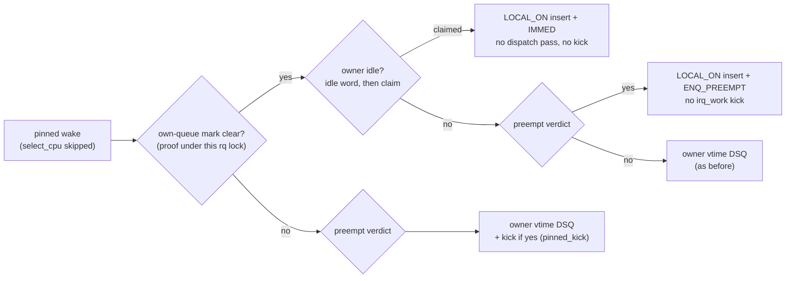
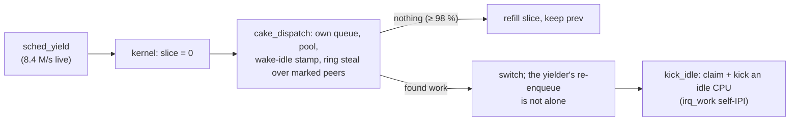
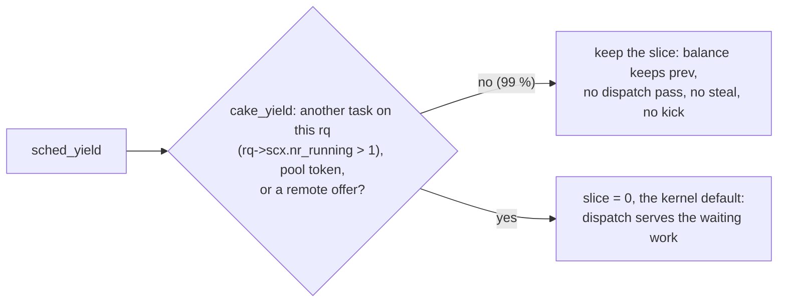

# Wake map: CPU-to-CPU wake latency against EEVDF (2026-10-29)

| | |
|---|---|
| ✅ §G100 pinned wake fast lane | default `26b8f2604` · level 3 (c2clat wake latency) ✅ against HEAD · level 1 ShadowGate, joint with §G101: equal on a quiet host, ahead beside a steady Blender (fps +2.0 %, 0.1 % low +6.7 %), worst frame lower in 8/9 pairs (p 0.039) · ⏳ a §G100-only arm, appsim (`cakebench cost`) |
| ✅ §G101 `ops.yield` keep | default `1218ad972` · level 3 (callback ns/run, yield rate, c2clat under a yield spin) ✅ against §G100 · level 1 ShadowGate, joint with §G100 (the game never yields) · ⏳ appsim, a Proton game, a Blender yield census, saturated host |
| Kernel | 🐧 stock: `LOCAL_ON` and `ENQ_PREEMPT` 6.12+; `SCX_ENQ_IMMED` 7.1+, compat 0 before, where the claim is a plain local insert; §G101 `ops.yield` and `rq->scx.nr_running` 6.12+ |
| Tree | committed on `58601ccdd` as `26b8f2604` (§G100) and `1218ad972` (§G101): `cake.bpf.c` (`cake_pinned_claim`, the continuation arm, `cake_yield`), `main.rs` (census names and the `pinned_claim == taciw_pinned` identity) |
| Receipts | HEAD `ffff4775…` · fast lane `d6e175c0…` · §G101 v1 `2676c2af…` ❌ · v2 `2f86d0cb…` (patches in `runs/locality_20261029/`) |

## §G100: what changed

The kernel skips `ops.select_cpu` for a task allowed on one CPU, so a pinned wake took the
continuation arm: the owner's vtime DSQ, then a `cake_dispatch` pass on the owner, plus an
irq_work kick when the preempt verdict fired.

Probe census (one short pass, `c2clat -w -s 50` then `-u -s 300`, about 2 s): `pinned_claim`
28,116 = `taciw_pinned` 28,116 of 28,198 tries; `pinned_preempt` 3,752, of which 301 went as
kicks behind own-queue work.

## Method

`scx_cake_bench/bench/locality/`: `c2clat -w` (pinned waker → pinned wakee by futex, 16 × 16
pairs × 200) and `c2clat -u` (unpinned wakee, 16 rows × 2,000), every sample raw;
`c2c_ab.py` interleaves EEVDF, HEAD and the fast lane, ABC then CBA, 6 rounds;
`c2c_report.py` gives each slot's percentiles by class (same CPU, SMT sibling,
cross-core) and an exact Mann-Whitney on slot values; `c2c_trace.py` splits each wake
into waking → wakeup → switch-in under `perf record` and names what ran on the landing CPU
and its sibling.

| Run | Slots | Validity | Load |
|---|---|---|---|
| `runs/locality_20261029/ab_20261029T140810` | 18 (6 per arm) | ✅ all: identity, hash, restore, no bad lines | all `noisy`: a Blender QA job at 3.1–3.5 CPUs (12 light slots), 9.1–9.4 in slots 9–13 (heavy: EEVDF 2, HEAD 2, fast lane 1), 4.3 in slot 14 |
| `runs/locality_20261029/trace_20261029T1425` | one pass per arm and mode | ✅ identity and hash | perf on: compare classes, never score |
| `runs/locality_20261029/storm_20261029T204823_ys3` | 12 (4 each: §G100, §G101 v1, v2) | ✅ all | `yieldspin 3`, bpf stats on, Blender 0, busy 19 % |
| `runs/locality_20261029/yieldrate_20261029T205821` | 6 (2 each: EEVDF, §G100, §G101) | ✅ all | `yieldspin 3 2`, no stats, no perf, Blender 0 |
| `runs/locality_20261029/ab_20261029T205404_ys3` | 18 (6 each: EEVDF, §G100, §G101) | ✅ all | `yieldspin 3` under c2clat; 13 light slots `warn` (outside 8–13 %); slot 10 a node process at 29 %; slots 14–17 Blender 5.6–8.2 CPUs |
| `runs/shadowgate_20261029/trial3_current_162321` | 1 (HEAD) | ✅ identity | ShadowGate, Epic; perf per thread on the game: a census, not an A/B |
| `runs/shadowgate_20261029/ab_head_v2_scal0` | 12 (6 each: HEAD, §G100 + §G101 v2) | ✅ all | ShadowGate, Low; 7 clean `low`; Blender in slots 1–2, `warn` slot 3, a Chrome capture on the GPU in slots 6–7 |
| `runs/shadowgate_20261029/ab2_v2_head_scal0` | 1 of 12 | ✅ slot 0 | aborted: Blender playback plus a node test (outside 48.7 %) stalled MangoHud's accept past 2 s at slot 1; a stall now fails only its slot |
| `runs/shadowgate_20261029/ab3_v2_head_scal0` | 12 (6 each, v2 first) | ✅ all | ShadowGate, Low, beside a steady Blender viewport playback (2.8 CPUs, 17–88 % SM): all `noisy` (outside 19.5 %), GPU-contended |

## Pinned map, light load

Median of 4 slots per arm, ns; p = 0.029 is the floor for 4 v 4 (all slots one way).

| Class | Stat | EEVDF | HEAD | §G100 | §G100 vs HEAD · vs EEVDF |
|---|---|---:|---:|---:|---|
| cross-core | p50 | 673 | 712 | ✅ 644 | p 0.029 · p 0.029 better |
| | p90 | 1,952 | 3,548 | 2,240 | −37 %, p 0.029 · +15 %, p 0.029 |
| | p99 | 6,096 | 8,976 | 8,140 | p 0.34 · +34 %, p 0.029 |
| | over 100 µs | 0.18 % | 0.13 % | 0.13 % | · fewer, p 0.029 |
| SMT sibling | p50 | 803 | 846 | ✅ 722 | p 0.029 · p 0.029 better |
| | p90 | 1,442 | 3,740 | 2,202 | −41 %, p 0.029 · +53 %, p 0.029 |
| | p99 | 4,458 | 16,558 | 14,660 | p 0.20 · ×3.3, p 0.029 |
| same CPU | p50 | 688 | 697 | 692 | ties |
| | p90 | 1,004 | 2,014 | 2,000 | p 0.89 · ×2, p 0.029 |
| pairs faster than EEVDF (pooled) | p50 · p90 | — | 19 · 0 of 256 | 223 · 16 of 256 | |

## Unpinned, light load

97–98 % of wakes land cross-core on every arm; §G100 does not touch this path (fast lane =
HEAD, p 0.11–0.89).

| Cross-core landings | EEVDF | HEAD | §G100 |
|---|---:|---:|---:|
| p50 | 1,000 | ✅ 654 | ✅ 650 |
| p90 | 1,980 | ❌ 2,755 | ❌ 2,746 |
| p99 | 3,874 | 4,260 | 4,346 |
| p99.9 | 55,174 | ✅ 14,880 | ✅ 15,616 |
| max | 696,263 | ✅ 41,568 | ✅ 46,049 |
| over 1 µs · over 100 µs | 49.4 % · 0.05 % | 24.1 % · 0 | 24.7 % · 0 |

Every cake vs EEVDF row: p 0.029.

## Heavy load (Blender 9.1–9.4 CPUs, descriptive: 2 · 2 · 1 slots)

| | EEVDF | HEAD | §G100 |
|---|---:|---:|---:|
| pinned cross-core p99 | 3.9 µs | 280 µs | 292 µs |
| unpinned cross-core p99 | 20.9 µs | 148 µs | 142 µs |
| wakes over 100 µs, pinned · unpinned cross | 0.36 · 0.51 % | 1.70 · 1.51 % | 1.93 · 1.40 % |

## Where the rest goes (trace)

Waking → switch-in, ns, by what ran at the waking instant.

| Pinned landing | Share EEVDF · §G100 | p50 EEVDF · §G100 | p90 EEVDF · §G100 |
|---|---|---|---|
| idle, sibling idle | 69 · 68 % | 664 · ✅ 635 | 904 · 885 |
| busy (Blender), sibling busy | 15 · 11 % | 1,770 · ❌ 2,741 | 2,423 · ❌ 5,020 |
| idle, sibling busy | 1.4 · 6.5 % | 1,077 · ❌ 1,971 | 2,029 · ❌ 2,924 |
| waker's CPU, sibling idle | 4.4 · 4.8 % | 683 · 692 | 817 · 750 |
| waker's CPU, sibling busy | 1.9 · 1.3 % | 1,077 · ❌ 1,981 | 1,471 · ❌ 2,462 |

| Unpinned landing | EEVDF n · p50 | §G100 n · p50 |
|---|---|---|
| idle, previous CPU | 10,084 · 683 | 12,409 · ✅ 635 |
| idle, moved | 4,027 · 1,029 | 615 · 1,317 |
| busy, previous CPU (preempt in place) | 1,864 · 1,807 | 183 · ✅ 1,260 |
| busy, moved | 25 · 2,664 | 2,793 · ❌ 2,423 |

Busy landings saw no idle CPU at the waking instant (median 0): Blender bursts to all 16
CPUs from a one-thread base.

A busy, moved unpinned wake under §G100 (3,019 ns)

| ns | CPU | Event |
|---:|---|---|
| 0 | 0 (waker) | `sched_waking` wakee, previous CPU 4 (Blender running) |
| +894 | 0 | `sched_wakeup` on CPU 4's rq: `select_cpu` returned CPU 4 undecided |
| +1,577 | 7 (Blender) | `sched_migrate_task` 4 → 7: enqueue bound a preemptible neighbour |
| +1,750 | 0 | waker blocks |
| +3,019 | 7 | `sched_switch` Blender → wakee |
| +4,192 | 4 | CPU 4 pulls the displaced Blender thread |

## The yield storm and §G101

Every slot of the first A/B ran beside a Blender QA job whose workers spin on `sched_yield`. EEVDF answers a
yield on the yielder's own runqueue. Without an `ops.yield` the kernel zeroes the slice and
the next balance runs a full `cake_dispatch`.

| Measure | Value | Source |
|---|---:|---|
| Blender `sched_yield` | 8.4 M/s at 3.3 CPUs | live `perf stat -a`, 2 s, cake `d287e1bb`, no c2clat |
| context switches | 146 k/s | same |
| IWI | 56.6 k/s live · 104–109 k/s in the A/B (EEVDF 0.1 k) | `/proc/interrupts` |
| ring-steal attempts that reached a move | 13.4 M, 141 ns each probe-timed (1.9 CPU-s) | probe pass, ~2 s |
| kicks | 191,775, 93 % behind a notify claim | probe pass |
| continuation inserts · skipped as alone | 298,500 · 309 | probe pass |
| Blender → Blender switches per trace pass | EEVDF 200,501 · cake 210,335 | perf, ~1.09 s each |

Cake used to keep yielders running. Up to 1.1.3, `cake_yield` only counted yields and
returned false, but having any `ops.yield` stops the kernel from zeroing the slice.

The 2026-08-18 squash `b65bba3bd` removed it as dead telemetry. The archive's open gap,
1.1.3 IPC 1.55 vs 1.48 for every 1.2.x arm, ruled yield out on that same reading ("1.1.3's
handler is telemetry"), so the kernel default was never tested as a cause.

§G101 puts the hook back with a test. The kernel calls `ops.yield` instead of zeroing the
slice, and the dispatch verdict keeps a queued prev that still has slice before it looks at the
local DSQ, so the hook gives way whenever anything waits for this CPU.

`rq->scx.nr_running` counts every sched_ext task enqueued on the rq, the yielder included, so
own-queue and local-DSQ tasks show in one per-CPU load; a pooled task can sit on any rq, so the
pool token covers those. v1 tested the own-queue mark and a local `scx_bpf_dsq_nr_queued` kfunc
instead, which reads the shared mark line on every yield.

| Probe census, v1, ~2 s beside Blender | §G100 | §G101 |
|---|---:|---:|
| yields kept · given up | — | 28,467,219 · 261,921 (0.9 %) |
| ring-steal attempts that reached a move | 12.8 M | 279 k |
| kicks · notify claims | 177.6 k · 171 k | 7.8 k · 4.3 k |
| time in moves | 1.78 s | 0.058 s |

| `yieldspin 3` (3 threads, `sched_yield` loop), ABC/CBA, Blender 0 | EEVDF | §G100 | v1 ❌ | v2 ✅ |
|---|---:|---:|---:|---:|
| per-yield callback, stats on, 4 slots | — | `cake_dispatch` 12.5 ns × 26.2 M/s | `cake_yield` 7.42 ns (7.39–7.45) × 30.3 M/s | `cake_yield` 7.28 ns (7.23–7.36) × 30.5 M/s |
| BPF total, stats on | — | 329.4 ms/s | 228.7 | 224.8 |
| IWI, stats on | — | 2,711/s (2,592–3,582) | 276 (177–392) | 285 (177–384) |
| yields/s, no stats, 2 slots | 53.7–54.1 M | 34.8–36.1 M | — | 38.2–41.3 M |
| per yield per thread, no stats | 55.6 ns | 84.7 ns | — | 75.5 ns |

v2 against v1: ns/run and BPF p 0.029. v2 against §G100: BPF, IWI and the stats-on yield rate
p 0.029. The last 20 ns per yield against EEVDF is the sched_ext path around a kept prev
(balance, pick, the struct_ops call), not cake's few ns (G7).

c2clat under the same spin, light slots (EEVDF 5 · §G100 4 · §G101 4), ns:

| | EEVDF | §G100 | §G101 | p §G101·§G100 |
|---|---:|---:|---:|---:|
| pinned same p50 · p90 | 731 · 1,020 | 991 · 1,187 | 697 · 957 | 0.029 · 0.029 |
| pinned same over 1 µs | 14.6 % | 47.2 % | 1.6 % | 0.029 |
| pinned SMT p50 · p90 · p99 · p99.9 | 808 · 1,395 · 1,586 · 7,837 | 721 · 938 · 3,644 · 72,535 | 721 · 918 · 3,866 · 82,584 | 1.0 · 0.086 · 1.0 · 0.89 |
| pinned cross p50 · p90 · p99 · p99.9 | 769 · 1,403 · 1,769 · 27,665 | 668 · 884 · 2,702 · 74,266 | 654 · 841 · 3,236 · 77,852 | 0.029 · 0.029 · 0.34 · 1.0 |
| pairs faster than EEVDF, p50 · p90 | — | 147 · 214 of 256 | 185 · 240 of 256 | |
| unpinned cross p50 · p90 · p99 | 952 · 1,260 · 1,885 | 678 · 962 · 1,808 | 664 · 946 · 1,750 | 0.029 · 0.34 · 0.26 |
| IWI/s | 7 | 5,157–7,144 | 321–433 | |

Heavy slots: Blender 5.6–8.2 CPUs beside the spin (EEVDF 1 · §G100 1 · §G101 2), descriptive

| | EEVDF | §G100 | §G101 |
|---|---:|---:|---:|
| IWI/s | 7 | 45.2 k | 3.1–3.4 k |
| pinned cross p99 | 3.7 µs | 264 µs | 17–232 µs |
| pinned cross over 100 µs | 0.30 % | 1.33 % | 0.55–1.33 % |
| unpinned cross p99 | 18.2 µs | 49.0 µs | 3.9–4.3 µs |

The same-CPU pinned wake gained most: under the spin §G100 lost it to EEVDF (p50 991 vs 731 ns)
and §G101 wins it (697). The pinned p99 and p99.9 did not move between the two cake arms, so the
SMT and cross-core tail is not the yield storm: G2 and G4 stay open.

## In a game: ShadowGate

ShadowGate is the maintainer's UE 5 shooter, run as its native Linux package (game sha
`1be8e7e1…`). Its ProfileMatch self-test opens an 8-bot Attrition match, settles 8 s, then
measures input-to-simulation and frame time over 20 s while a 1,000 Hz SDL mouse thread
feeds it; MangoHud logs every frame of the window. Harness
`scx_cake_bench/bench/locality/sgprofile.py`, report `sgreport.py`.

| Census: HEAD, Epic 1280×720 (~205 fps, GPU 86 %), `perf stat --per-thread` on the game, 19.5 s | `sched_yield`/s | switches/s |
|---|---:|---:|
| all 42 threads | 0 | 126,116 |
| Background workers ×10 | 0 | 30,784 |
| `RHIInterrupt` | 0 | 28,523 |
| Foreground workers ×2 | 0 | 17,528 |
| `ShadowGate` threads ×5 | 0 | 16,965 |
| `RHIThread` · `RHISubmission` · `RenderThread` | 0 | 9,276 · 7,985 · 6,801 |

The same perf command counts ~9.4 M yields/s per thread on `yieldspin 2 4`, so the zero is a
reading. The game blocks and wakes and never spins on `sched_yield`: §G101 has nothing to keep.
No game thread is pinned, so §G100 reaches only kernel threads (kworkers, threaded IRQs).

A/B: HEAD `d287e1bb` against §G100 + §G101 v2 `2f86d0cb`, Low 1280×720, uncapped, Reflex on,
VSync off: CPU-limited (~485 fps, GPU ~80 %). 6 slots per arm ABBA, all valid.

| Clean `low` slots, HEAD 4 · v2 3 | HEAD | v2 | p |
|---|---:|---:|---:|
| input-to-simulation p50 · p99, ns | 1,097,340 · 2,743,546 | 1,120,471 · 2,832,953 | 1.0 · 1.0 |
| frame p50 · p99, ns (game) | 1,973,154 · 2,992,996 | 1,973,501 · 3,014,920 | 0.86 · 1.0 |
| avg fps · 1 % low · 0.1 % low | 488 · 293 · 211 | 480 · 285 · 218 | 1.0 · 1.0 · 0.40 |
| p99.9 · worst frame, ms | 4.00 · 6.86 | 4.07 · 5.58 | 1.0 · 0.11 |
| GPU · external CPU | 80.0 % · 3.42 % | 81.0 % · 3.35 % | |

| Adjacent clean pair, v2 vs HEAD | input p99 | frame p99 | avg fps | worst frame, ms |
|---|---:|---:|---:|---:|
| 4–5 | −0.19 % | −3.34 % | +0.94 % | 7.38 → 6.23 |
| 8–9 | −0.38 % | +0.25 % | +1.02 % | 8.28 → 5.43 |
| 11–10 | +1.55 % | −0.88 % | −2.24 % | 6.33 → 5.58 |

Frames are equal: the pair signs flip and every median sits within 3.3 %. The one lean is the
worst frame, lower under v2 in all three pairs; three pairs cannot part that from chance (sign
test 0.25, Mann-Whitney 0.11), six clean pairs can. Neither change fires for the game itself, so
a real effect would come through kernel threads (§G100) or another process's yields (§G101).

Run 3, same settings, v2 first, beside a steady Blender viewport playback: it held 2.8 CPUs and
17–88 % SM through all 12 slots, matched across arms, so every slot is `noisy` and GPU-contended
(~395 fps, GPU 83 % shared).

| Run 3, all 12 valid | HEAD (6) | v2 (6) | p |
|---|---:|---:|---:|
| input-to-simulation p50 · p99, ns | 1,351,147 · 5,539,680 | 1,315,189 · 5,517,218 | 0.065 · 0.70 |
| frame p50 · p99, ns (game) | 2,347,619 · 6,154,812 | 2,288,088 · 6,085,136 | 0.065 · 0.13 |
| avg fps · 1 % low · 0.1 % low | 393 · 149 · 119 | 401 · 152 · 127 | 0.065 · 0.093 · 0.026 |
| p99.9 · worst frame, ms | 7.57 · 9.87 | 7.39 · 8.56 | 0.24 · 0.065 |
| frame stddev, ms | 0.796 | 0.768 | 0.041 |
| GPU · outside CPU · Blender CPUs | 83.4 % · 19.53 % · 2.80 | 82.8 % · 19.52 % · 2.81 | |

| Pooled pairs, v2 vs HEAD (run 1 clean 3 + run 3 all 6) | v2 better | median | sign p | signed-rank p |
|---|---:|---:|---:|---:|
| worst frame, MangoHud | 8/9 | −14.81 % | 0.039 | 0.012 |
| worst frame, game ns | 8/9 | −8.89 % | 0.039 | 0.039 |
| 0.1 % low fps | 8/9 | +7.38 % | 0.039 | 0.008 |
| avg fps | 7/9 | +1.02 % | 0.18 | 0.16 |
| frame p50 · p99 | 7/9 · 6/9 | −1.03 · −0.88 % | 0.18 · 0.51 | 0.16 · 0.098 |
| input p50 · p99 | 7/9 · 5/9 | −1.01 · −0.19 % | 0.18 · 1.0 | 0.20 · 0.82 |

The worst-frame lead holds: named before run 3, it fell under v2 in 8 of 9 pairs across both
runs (sign test 0.039). Beside Blender the joint build also lifts the average (fps +2.0 %, frame
p50 −2.5 %, both p 0.065) and the 0.1 % low (+6.7 %, p 0.026). Two cautions: small extra GPU
users (two desktop apps, 8–13 % SM) showed in HEAD slots 2, 5, 6 and 9 and in no v2 slot, and
the build joins §G100 and §G101. The game neither yields nor pins, so the gain comes through
other tasks: kernel threads (§G100) or Blender's yields (§G101, not yet counted). A §G100-only
arm splits them.

Run 1: slots left out, and the game-side by-products

| Slot | Arm | Why out |
|---|---|---|
| 1 · 2 | v2 | Blender 3.3 · 7.2 CPUs, `noisy` (external 23.8 · 46.1 %) |
| 3 | HEAD | `warn`, external 6.6 % |
| 6 · 7 | v2 · HEAD | GPU-contended: GPU 97 % at ~230 fps; `nvidia-smi pmon` showed an outside Chrome capture at 48 % SM; slot 7 snapped back to ~450 fps at second 14 with no scheduler change |

Unfiltered, the medians favour HEAD (input p99 +24 %) only because three of the four lost slots
fell on v2. The harness now samples `nvidia-smi pmon` over the window (`gpu_noise=contended` at
5 % SM from any other process) and counts Blender per pid.

Equal in every slot: ProfileMatch FAILs its own IO guard on this package (13 blocking
game-thread calls: font reads, a sync-load of `M_TeamOutline`, 8 PSO misses), the input max is
~52 ms, and 54–55 % of reports arrive while not looking.

Where yields live: Wine's `NtYieldExecution` is a `sched_yield()`, and a non-alertable
`NtDelayExecution` yields before it sleeps, `Sleep(0)` included (upstream Wine source; Proton's
fork not checked). Every finite `Sleep` and `SwitchToThread` in a Windows game under Proton
reaches `ops.yield`, so the game test of §G101 is a Proton game: census first, then the A/B.

## Gaps left

| # | Gap | Evidence | Next | Kernel |
|---|---|---|---|---|
| G1 | preempting a busy occupant: pinned p50 2,741 vs 1,770 ns | trace | price the displaced task's `stopping` and re-enqueue that run before the switch-in | 🐧 |
| G2 | busy SMT sibling: idle or same-CPU landing +0.9 µs, while an idle sibling is faster than EEVDF | trace, 5 classes | §G101 left the SMT tail where it was (p99.9 83 vs EEVDF 7.8 µs under the spin): trace it with §G101 in | 🐧 |
| G3 | unpinned with no idle CPU: the neighbour is chosen in enqueue, after the wakeup, so the wakee migrates late | trace | choose the preemptible neighbour in `select_cpu` so ttwu activates it on that rq | 🐧 |
| G4 | saturation tail: 1.4–1.9 % of wakes over 100 µs vs 0.4–0.5 % | heavy slots (2 · 2 · 1) | rerun heavy with §G101 (one or two slots so far: IWI 45 k → 3 k/s, pinned cross p99 264 → 17–232 µs), then trace: a declined verdict waits out a protected occupant's slice | 🐧 |
| G5 | same-CPU p90 ×2 in the A/B, but the trace ties it except beside a busy sibling | A/B vs trace | folds into G2 unless a no-perf trace says otherwise | 🐧 |
| G6 | ✅ the background `sched_yield` spin: a full dispatch pass per yield, ~100 k idle kicks/s | §G101 under `yieldspin 3`: same-CPU p50 991 → 697 ns, IWI 5–7 k → 0.3–0.4 k/s | closed at level 3; appsim owed; ShadowGate never yields (the joint build leads in the tail beside Blender); a Blender yield census and a Proton game next | 🐧 6.12+ |
| G7 | the sched_ext yield path: 75.5 ns per yield per thread with `cake_yield`, EEVDF 55.6 | `yieldrate`, no stats | price `yield_task_scx`, balance and pick around a kept prev; a short cut when `ops.yield` kept the slice | 🧩 |
| G8 | §G101 on a saturated host: a yielder keeps its slice while a busy peer's queue waits (EEVDF's yield is local too) | design | saturated A/B (hogs on every CPU, the spin, `c2clat -u`); if it costs, give way when the die has no idle CPU and a peer is marked | 🐧 |
